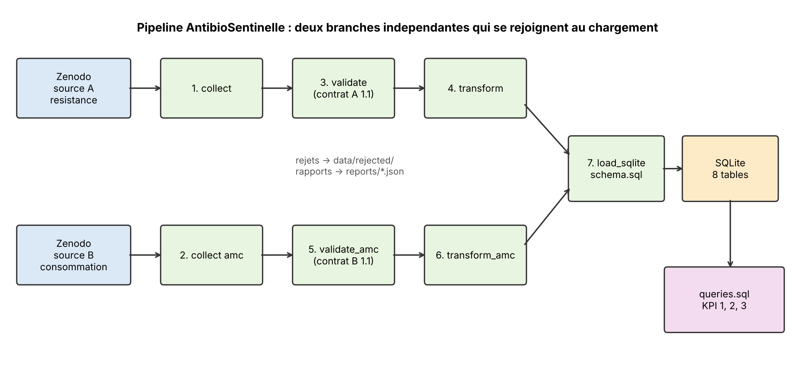

# Architecture v2 d'AntibioSentinelle (6 novembre 2026)

## Exigences
- Fonctionnelles : comparer, par pays et par année, la résistance (hôpital) et la consommation (ville, secteur Community), avec 3 KPI.
- Non fonctionnelles : reproductible, contrôlé (contrats de données), traçable, sans donnée personnelle.

## Parties prenantes
- Auteur : développe et défend le projet.
- Enseignant : évalue la démarche et les choix.
- Lecteur ou utilisateur futur : doit pouvoir relancer le pipeline avec le README.
- Producteurs des données : ECDC, puis Zenodo.

## Choix d'architecture
- **Batch, pas streaming** : les données sont publiées par année et changent rarement.
- **ETL** : le nettoyage et la validation se font en Python avant le chargement. Les KPI sont ensuite calculés en SQL dans la base : le pipeline est donc un ETL suivi d'un calcul analytique SQL.
- **Analytique (OLAP) à petite échelle** : les requêtes sont des agrégations et des jointures. SQLite stocke par lignes, ce qui suffit pour ~16 000 lignes (voir ADR 001).
- **CSV, pas Parquet** : les fichiers sont petits et lisibles par n'importe qui. Parquet serait utile pour de gros volumes ou des types stricts.
- **SQL, pas NoSQL** : les données sont tabulaires, avec des relations claires et des contraintes à faire respecter.

## DAG du pipeline

Source A (résistance) : collect → validate → transform.
Source B (consommation) : collect → validate_amc → transform_amc.
Les deux branches sont indépendantes et se rejoignent dans `load_sqlite`, puis viennent les requêtes SQL. Le pipeline les exécute aujourd'hui l'une après l'autre (7 étapes), mais elles pourraient tourner en parallèle.

## Observabilité
Chaque exécution écrit `reports/run_report.json` et `reports/run_report_amc.json`. Les lignes rejetées sont gardées dans `data/rejected/`. Le chargement SQLite affiche les nombres de lignes, et on contrôle l'intégrité avec `integrity_check` et `foreign_key_check`. Il n'y a ni alerte automatique ni tableau de bord : c'est une limite.

## Gouvernance
- Contrats de données : A en 1.1, B en 1.1, versionnés, avec leurs problèmes connus.
- Grille RGPD (`docs/grille_rgpd.md`) : aucune donnée personnelle.
- Journal des décisions dans `docs/cadrage.md`, ADR dans `docs/adr/`, commits séparés.

## Limites connues
La voie « All » est ambiguë et traitée par une règle testée. Il y a un effet de composition au niveau des classes. Les valeurs `anomalie_valeur` ne sont pas exclues des KPI. La couverture est inégale selon les pays. La règle sur « All » est copiée dans trois requêtes SQL.