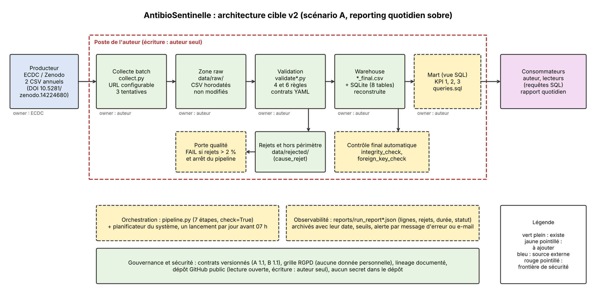

# Architecture cible v2 d'AntibioSentinelle (7 novembre 2026)

Scénario retenu : **A, reporting sobre** (mise à jour quotidienne, équipe d'une personne). Le diagnostic, les exigences chiffrées et les tableaux détaillés sont dans `docs/seance3.md`. La décision est dans `docs/adr/001-architecture-cible.md`.

L'architecture actuelle (version 1, pipeline réel en 7 étapes) est dans `docs/architecture.png`. Le schéma visé en séance 1 est dans `docs/architecture_v1.png`.

## Ce qui change entre la version 1 et la version 2

| Ajout (jaune pointillé sur le schéma) | Problème qu'il résout |
|---|---|
| Planificateur du système (un lancement par jour avant 07 h) | Exigence de fraîcheur : aujourd'hui le pipeline est lancé à la main. |
| Porte qualité : `FAIL` si plus de 2 % de lignes invalides, et arrêt du pipeline | Aujourd'hui une ligne invalide donne `PASS_WITH_WARNINGS` et `FAIL` n'apparaît que si aucune ligne n'est acceptée. |
| Contrôle final automatique (`integrity_check`, `foreign_key_check`) | Aujourd'hui ces contrôles sont lancés à la main, hors pipeline. |
| Mart sous forme de vue SQL | Éviter des KPI contradictoires : tous partent de la même définition. |
| Rapports archivés avec leur date, alerte | Aujourd'hui chaque rapport écrase le précédent et il n'y a pas d'alerte automatique. |

Aucune technologie n'est ajoutée sans problème identifié. Les briques écartées (streaming, Kafka, Parquet, NoSQL, orchestrateur, serveur de base) le sont dans la comparaison ci-dessous.

## Comparaison de trois options

| Option | Description | Bénéfice | Coût ou risque |
|---|---|---|---|
| Simple | Script planifié et base SQL : le pipeline actuel, lancé chaque jour par le planificateur. | Aucun développement ni serveur. Répond à l'exigence de fraîcheur. | Aucune porte qualité : des données dégradées passent sans arrêt. Contrôles finaux manuels. KPI sans définition commune. L'objectif de service (moins de 2 % de rejets) ne peut pas être vérifié automatiquement. |
| **Cible (retenue)** | Option Simple, plus la porte qualité à 2 %, le contrôle final automatique, la vue SQL du mart, les rapports archivés et une alerte simple. | Respecte les six exigences et l'objectif de service. Détecte les données dégradées. Reste maintenable par une personne. | Quelques scripts à écrire et un seuil à entretenir. L'alerte reste simple (message d'erreur ou e-mail). |
| Évolutive | Orchestrateur (par exemple Airflow), base serveur (par exemple PostgreSQL), stockage Parquet, tableau de bord de métriques. | Exécution parallèle, historique, plusieurs utilisateurs, supervision visuelle. | Un serveur à installer, surveiller et mettre à jour, pour 16 454 lignes et une seule personne. Aucune exigence ne le demande. |

**Règle de décision du sujet :** retenir l'architecture la plus simple qui satisfait les exigences mesurables et dont l'équipe peut assurer l'exploitation. L'option Simple ne satisfait pas l'objectif de service (qualité et contrôle automatiques) ; l'option Évolutive dépasse ce qu'une personne peut exploiter. L'option **Cible** est donc retenue.

## État d'avancement

Le schéma décrit la cible. Aujourd'hui, seuls les éléments en vert plein existent. Les ajouts en jaune pointillé ne sont pas encore codés.
